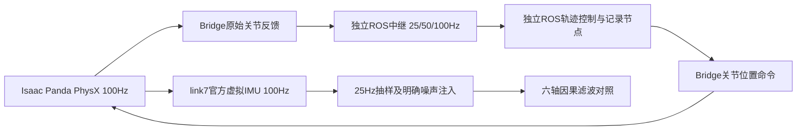

# 字节机器人：IMU 状态反馈滤波与控制频率分析报告（Week 2 自主补充）

日期：2026-10-13；Ubuntu22.04 / RTX4090 / ROS2 Humble / Isaac Sim5.1。

这份报告依据字节《机器人控制算法岗月度工作计划表》的 Week 2 大框架自主扩展，与老师具体下发的 Week 1 Task1 报告分开。新增真实运行的 Panda/ROS2 反馈频率对照、Isaac 虚拟 IMU 静止与运动记录、六轴因果滤波实现，以及 ROS2 原始/滤波消息发布验证。不是只描述后续计划。本轮完成软件与仿真部分；尚未完成真实 IMU 静止/运动采集。

## 1. 原任务覆盖与成果来源

| 月度计划 Week 2 内容 | 本轮完成内容 | 数据来源与边界 |
|---|---|---|
| 读取并发布多轴状态 | 六轴 ROS2 Imu 原始/滤波节点与独立订阅验证；厂家 RAW 串口只读接口 | 发布验证使用明确标记的离线回放；真实串口分支尚未运行 |
| 静止/运动原始采集 | Panda link7 上官方虚拟 IMU 的实际物理仿真记录 | 仿真读数，不是实体板卡实测 |
| 滤波与平滑分析 | 5点移动平均、EMA、二阶 Butterworth；误差及滞后对照 | 在虚拟IMU基础上显式注入已知高斯噪声，参数不是实测估计 |
| 多种反馈频率稳定性/延迟 | 25、50、100Hz各4次正反向平衡实验 | 真实ROS Bridge与两个外部ROS节点；物理步长固定10ms |
| 频率影响比较 | 主机频率、间隔P95、消息完整性、链路延迟、跟踪误差 | 延迟定义限定链路，不声称完整硬件端到端响应 |

主实验 `runs/run002_balanced`；先导 `run001` 保留但不作为主要频率精度结论。先导9阶段存在运动方向分布不平衡，后续重跑12阶段，每个频率正/反各两次，减少该混杂因素。重复次数仍很少，同一物理场景，未做跨机器或负载条件统计。

## 2. 仿真及实际 ROS2 链路

复用 Week1 的 Panda 资产、五次轨迹和 Isaac 独立环境，新增专用话题，不覆盖原工作空间。

仿真10ms固定步长；中继按仿真时戳抽取反馈，控制节点在每个已接收反馈时更新位置目标。因此比较的是**外环状态反馈/命令更新频率**，不是改变 PhysX 内部驱动控制频率。状态及命令使用 `/panda_week2/`，ROS domain51、localhost、FastDDS。

每阶段2秒保持、5秒五次轨迹、2秒保持，共12阶段约108秒。前三关节端点同Week1，正反方向交替，其余关节目标保持。静止区指令不变，不假设传感器完全无噪声。原始反馈接收共10798条，相邻仿真时戳最大间隔10ms，未发现超过15ms的缺口。中继发送到控制订阅的序号无缺失/重复。

IMU挂载 `/World/Panda/panda_link7/Week2IMU`，局部姿态为单位四元数，读取三轴加速度、角速度和wxyz四元数；内部滤波宽度均1。加速度读取包含重力，静态不同姿态的重力投影会改变，不能当成平移加速度。传感器频率不能高于物理频率，故本轮上限100Hz。

## 3. 反馈频率、误差与响应结果

表内为每频率4阶段指标的算术平均；“间隔P95平均”不是合并全部样本后的P95。关节RMSE只统计每阶段2–7秒运动窗口，比较同一时戳参考与实际位置，无滞后补偿。

| 请求Hz | 次数 | 实测主机Hz | 接收间隔P95平均 ms | 中继链路P95平均 ms | J1 RMSE rad | J2 RMSE rad | J3 RMSE rad | J1拟合滞后 ms |
|---|---:|---:|---:|---:|---:|---:|---:|---:|
| 25 | 4 | 24.891 | 40.964 | 0.259 | 0.021783 | 0.015586 | 0.016388 | 227.5 |
| 50 | 4 | 49.639 | 21.129 | 0.214 | 0.020832 | 0.014911 | 0.015675 | 217.5 |
| 100 | 4 | 99.270 | 10.891 | 0.166 | 0.020370 | 0.014582 | 0.015328 | 215.0 |

- 中继链路延迟：同一机器 monotonic 时钟下，中继 publish 调用前时刻到控制节点接收时刻，包括DDS与调度，不包含 Isaac→中继传输，不能写成整条机器人通信延迟。
- 拟合滞后：对参考轨迹搜索0–400ms、5ms步长的时间移位，求实际关节位置最接近的移位；是驱动动态与更新链路共同形成的描述量，不是纯网络延迟。表中的原始RMSE仍未移位。
- 100Hz的主机频率约99.27Hz，存在调度抖动，不能声称硬实时。提高外环频率后J1平均RMSE略降，但幅度有限，默认物理驱动仍产生明显跟踪滞后；没有证明仅提高频率可以消除误差。
- 改善仅针对同一仿真场景、默认驱动与本条轨迹。未引入力传感、导纳、姿态融合或真实机器人控制。

## 4. 虚拟 IMU 因果滤波与噪声/滞后权衡

在实际100Hz虚拟IMU读数上每4帧抽一帧，得到25Hz数据，接近既有真实板卡历史输出频率。主实验抽样数2782；其中静止/运动评估区间在指标JSON中明确保存。加入独立零均值高斯噪声：加速度每轴σ=0.15m/s²，角速度每轴σ=0.02rad/s，固定seed20261013。噪声模型是人为设定，不是实体IMU标定结果。

只用当前与历史样本：

- 移动平均：最近5个样本，完整窗口的线性相位延迟约80ms。
- EMA：截止频率3Hz，`α=1-exp(-2πfcΔt)`；可用实际采样间隔更新，无前视。
- 二阶Butterworth：3Hz截止、25Hz设计采样率、SOS形式逐样本运行；没有使用非因果filtfilt。采样率变化时应重新设计系数。

误差为输出减去**同一时刻的干净虚拟IMU读数**。表中多轴RMSE汇总三个轴，降噪比例相对加入噪声的raw误差；没有把滤波后的曲线平滑程度当成精度。动态误差未做时间对齐，保留滤波延迟代价。

| 算法 | 静止加速度误差RMSE m/s² | 减少 | 静止角速度误差RMSE rad/s | 减少 | 运动角速度误差RMSE rad/s | 角速度最佳移位 ms |
|---|---:|---:|---:|---:|---:|---:|
| raw | 0.14903 | 0.0% | 0.01983 | 0.0% | 0.02002 | 0 |
| moving_average | 0.06335 | 57.5% | 0.00915 | 53.9% | 0.00930 | 80 |
| ema | 0.08870 | 40.5% | 0.01203 | 39.3% | 0.01197 | 40 |
| butterworth | 0.07292 | 51.1% | 0.01028 | 48.1% | 0.01027 | 80 |

移动平均在此噪声和慢速轨迹条件下降噪较强，但引入约80ms滞后；EMA降噪较弱，拟合移位约40ms。移位以40ms采样网格计算，只用于描述，不抵消表中误差。常值与阶跃检查验证没有运动发生前的提前响应。因采样分辨率较粗，EMA首次变化即超过阶跃50%并不意味着零相位延迟。

这轮优先选EMA作为演示发布默认值，保留其余算法对照；未给出所有运动速度下的最优参数，也未证明真实IMU同样改善。没有修改既有HTML姿态显示或板卡安装轴，没有对四元数做不合适的逐分量平均，当前六轴滤波与姿态融合分开。

## 5. 实际 ROS2 IMU 原始/滤波发布验证

另用先导实验带噪CSV做10秒离线回放，独立发布进程在线计算EMA，独立订阅进程记录 sensor_msgs/Imu。CSV没有四元数字段，显式设置orientation不可用；没有假装获得融合姿态。

| 话题 | 发送/接收 | 缺失/重复 | 主机Hz | 发布至接收P95 ms |
|---|---:|---:|---:|---:|
| /imu_week2/raw | 249/249 | 0/0 | 25.000 | 0.864 |
| /imu_week2/filtered | 249/249 | 0/0 | 25.000 | 0.969 |

原始/滤波消息采用固定坐标系名imu_sensor，以相同ROS时间戳关联独立收发记录；六轴值与发布端记录最大差异0，两个进程正常退出。延迟起点为样本处理开始时刻，包含滤波计算、消息构建、DDS与调度；不包含CSV历史生成、原始传感器采样或串口延迟。此验证证明ROS接口能发送/接收，并非实体传感器联调。

真实串口分支已实现：使用原厂家驱动、115200接收有效RAW包、g→m/s²、rad/s保留、可附上已收到的板卡四元数；不写入校准、输出频率或Flash。当前设备未连接，只完成代码检查，该分支尚待真实运行验证。

## 6. 未完成项

后续补项是实体板卡静止/运动数据、真实单位/安装轴核验、串口时戳与ROS消息对齐、真实噪声及响应对照；本轮没有涉及Jetson侧验证，也没有力反馈/导纳或LQR。
