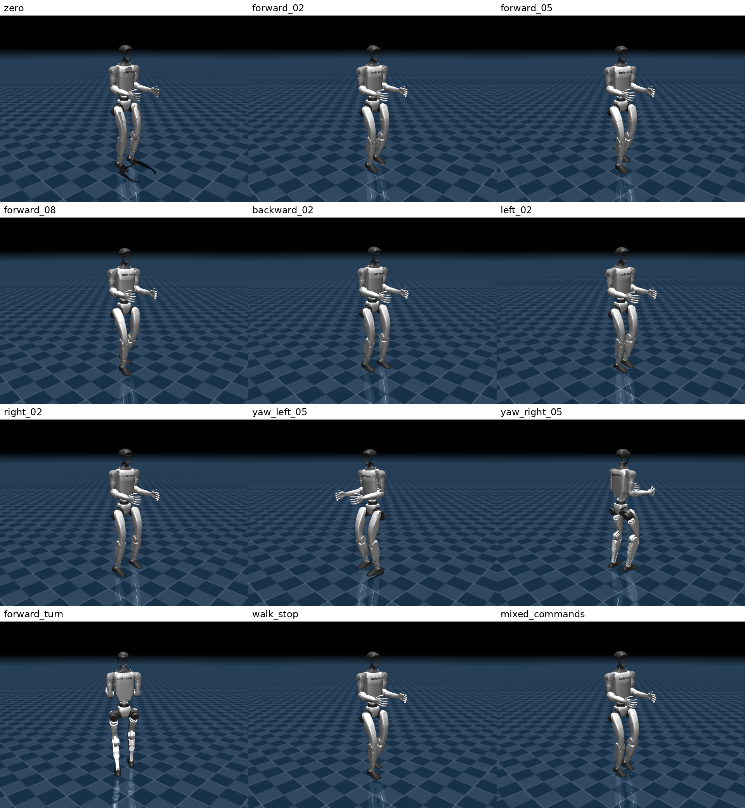
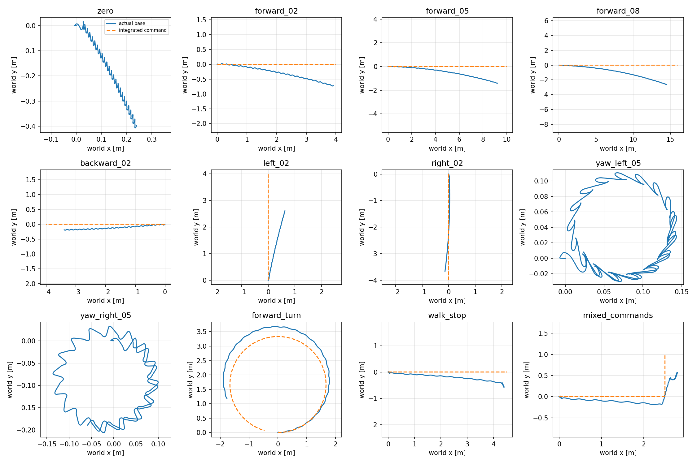
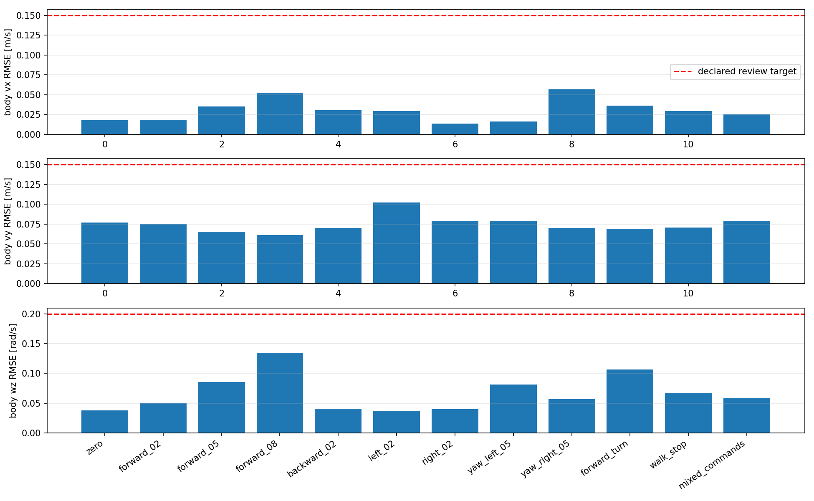
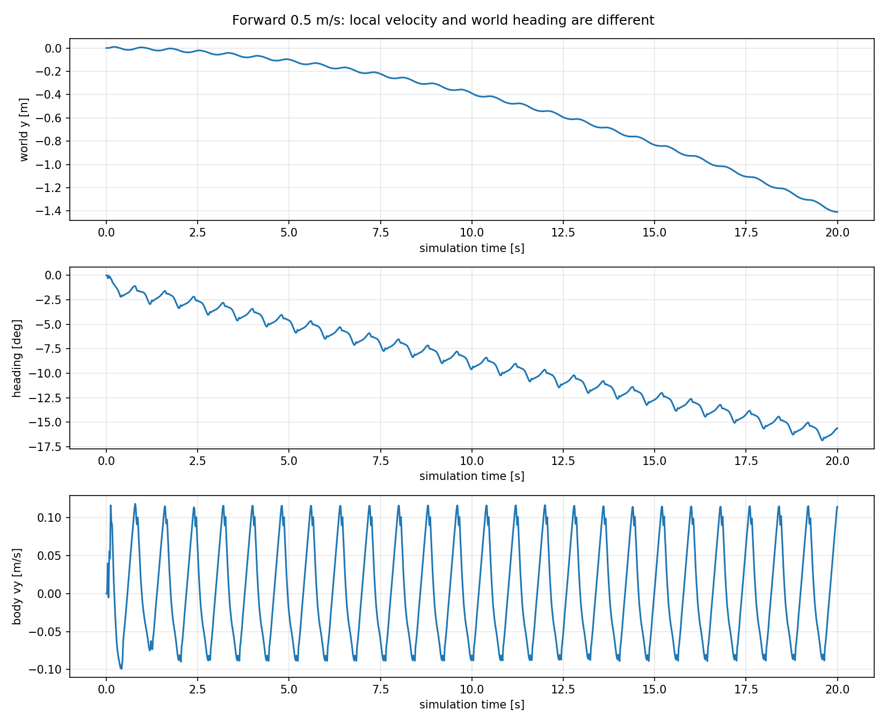
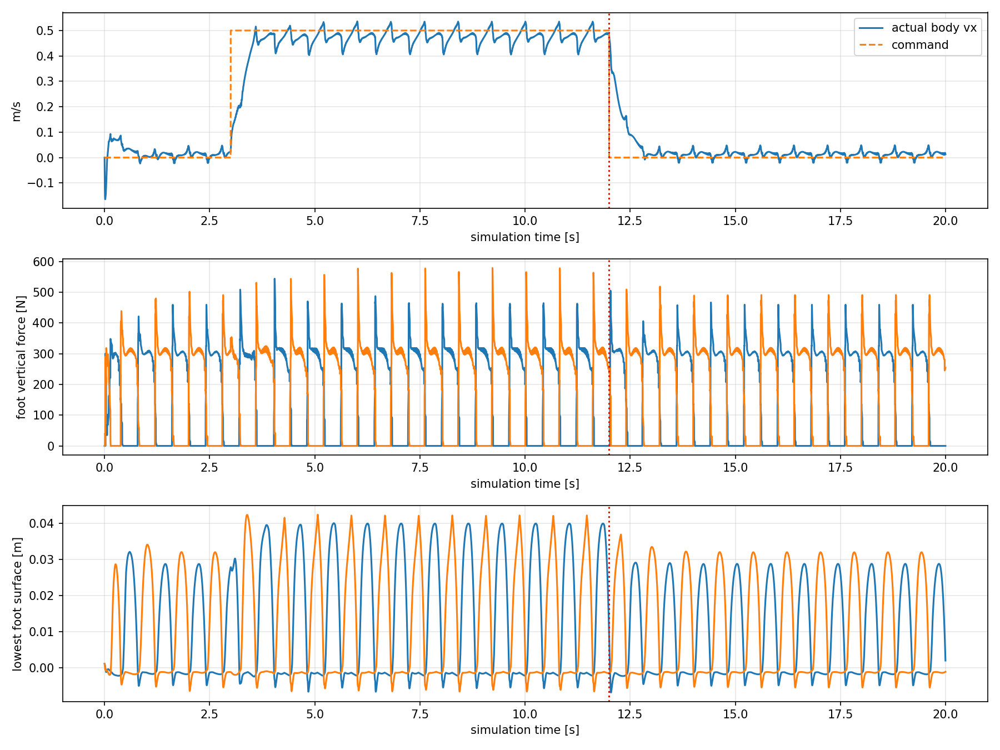

# G1 行走基线复核：步态、方向与停止

2026年11月15日 · 阶段报告

## 摘要

本轮针对视频中“飘飘忽忽”的观感，复核已有准静态控制原型与宇树官方强化学习行走基线。官方预训练策略没有修改、没有重新训练；新增的是观测接口核对、12种速度工况、接触测量、状态保存和视频复核。

12种工况共运行245秒仿真，记录122500个物理步、12250次策略调用，均达到设定时长，没有触发本轮跌倒或非脚部接地终止条件。这是同一初始状态下的功能验证，不是12次随机试验的成功率。

主要结果有三点。第一，官方策略存在连续交替抬脚和受力接触，并非直接拖动浮动基座。第二，前进指令0.5米/秒时，20秒前进9.23米、横移−1.41米、航向变化−15.63度；前进速度接近指令不能代表直线跟踪准确。第三，归零后机身净移动减慢，但脚仍持续踏步，未达到预设的瞬时速度持续1秒停止条件。因此，本轮确认了动态行走基线，也明确了方向保持与站立切换的缺口。



## 1. 两条控制路线的定位

已有WBC（全身控制）使用29个电机的模型，结合动力学约束、力矩控制与慢速准静态轨迹，适合分析承重、接触和约束实现。约7秒的阶段时长是参考轨迹的设置，不能仅凭视频慢就断言控制算法错误；但它也没有完成自然动态行走的验证。

本轮复核的RL（强化学习）策略来自宇树官方unitree_rl_gym，使用12个电机的G1模型。我们复现官方预训练策略与部署循环，未训练新策略。两条路线的模型、任务和参考速度均不同，视频可以解释观感差异，不能作为同条件算法优劣排名。

对照视频：`wbc_vs_official_rl_first20s.mp4`。两侧均按原速播放；左侧仅取原29秒WBC视频的前20秒，右侧为官方策略0.5米/秒前进。完整WBC视频仍在原实验目录保留。

## 2. 上游与接口核对

上游仓库：https://github.com/unitreerobotics/unitree_rl_gym ，许可证BSD-3-Clause。固定提交为`276801e46c5d433564f24658bac64f254b7d2d4b`。

策略文件为`deploy/pre_train/g1/motion.pt`，SHA256为`cf668f75b90d1abf73d2b87612a6e76bccc61ff7e083b63582d3f6aaa3c1759d`。模型包含循环神经网络状态，因此每个工况重新加载策略，避免前一回合的隐状态影响下一回合；没有额外预热推理。

物理步长0.002秒，即500赫兹；策略每10个物理步调用一次，即50赫兹。47维观测包含角速度、重力投影、速度指令、关节位置与速度、上次动作和步态相位。动作乘0.25后叠加默认关节角，通过官方比例与微分控制参数产生电机力矩。浮动基座没有外加驱动力。

5项接口测试通过：随机输入的观测向量与官方代码片段一致；力矩计算一致；重力投影与坐标变换一致；策略隐状态重新加载可复位；连续500个物理步的新旧循环状态一致，允许误差为1e−12。

保存状态又进行独立运动学复算：每个工况抽查31个状态，位置最大差为0，机体系速度误差处于浮点舍入量级。录制时不在真实控制循环里增加额外正向计算，避免改变接触求解时序。

## 3. 工况与判定口径

固定12种工况：零指令，前进0.2、0.5、0.8米/秒，后退0.2米/秒，左右横移0.2米/秒，左右转向0.5弧度/秒，前进并转向，行走后归零，以及多指令切换。前11种各20秒，最后一种25秒。

协议与源码快照在运行前保存在`PROTOCOL.json`和`source/`。每次指令变化后的前3秒不计入稳态速度误差。线速度均方根误差门槛为每轴0.15米/秒，角速度为0.20弧度/秒。这些门槛较宽，只用于本轮功能检查。

安全终止条件包括：基座高度低于0.4米；倾斜超过60度持续0.1秒；非脚部对地力超过20牛顿持续0.1秒；状态非有限值。通过这些条件不等于完成鲁棒性认证。

停止条件在运行前确定：瞬时平面速度不超过0.10米/秒，且绝对转速不超过0.15弧度/秒，连续保持1秒。归零测试保留该条件，未因结果不通过而更换标准。

## 4. 速度与方向结果

下表速度误差依次为机体系前后、左右和转向；位移为世界坐标下的浮动基座位移。基座位置与全身质心分开记录，不能混称质心。

| 工况 | 世界X/Y位移（米） | 速度误差（米/秒，米/秒，弧度/秒） | 航向变化（度） |
|---|---:|---:|---:|
| 零指令 | 0.240 / -0.397 | 0.018 / 0.077 / 0.038 | -10.6 |
| 前进0.2 | 3.916 / -0.725 | 0.019 / 0.075 / 0.051 | -11.2 |
| 前进0.5 | 9.228 / -1.409 | 0.035 / 0.066 / 0.086 | -15.6 |
| 前进0.8 | 14.532 / -2.617 | 0.052 / 0.061 / 0.135 | -19.6 |
| 后退0.2 | -3.395 / -0.186 | 0.030 / 0.070 / 0.041 | -5.1 |
| 左移0.2 | 0.628 / 2.609 | 0.030 / 0.102 / 0.037 | -5.0 |
| 右移0.2 | -0.139 / -3.662 | 0.014 / 0.079 / 0.040 | -10.4 |
| 左转0.5 | 0.134 / 0.052 | 0.016 / 0.079 / 0.081 | 534.6 |
| 右转0.5 | -0.059 / -0.190 | 0.057 / 0.070 / 0.057 | -553.3 |
| 前进并转向 | -1.772 / 1.185 | 0.036 / 0.069 / 0.107 | 293.1 |
| 行走后归零 | 4.400 / -0.574 | 0.029 / 0.071 / 0.068 | -10.6 |
| 多指令切换 | 2.782 / 0.569 | 0.025 / 0.079 / 0.059 | 124.4 |

12种工况均满足上述较宽的速度误差门槛。更细看，左移指令0.2米/秒的稳态均值约0.133米/秒，存在欠跟踪；右移约−0.185米/秒，左右并不对称。不能用“全部通过”掩盖这些差异。





前进0.5米/秒的结果准确复现了早先记录的9.23米前进和−1.41米横移。稳态前进速度均值约0.476米/秒，但航向从第3秒的−3.49度逐渐变到终点−15.63度。

事后运动学分解显示，世界Y方向位移中，机体前向运动投影贡献约−1.442米，机体侧向运动投影约+0.041米，其余约−0.007米。它说明横移主要与运动方向旋转相关；这只是几何分解，并未定位策略航向漂移的内部成因。



## 5. 归零并不等于站定

行走后归零工况在第12秒将指令设为零。之后8秒基座仍移动约0.207米和−0.184米，并记录到20次抬脚后重新加载接触的事件。单独零指令回合在第3秒以后也有42次同类事件，说明该策略维持了踏步周期。

行走归零与多指令归零均未达到预设的瞬时停止条件。为了区分机身摆动与持续行进，又增加事后诊断：以1秒窗口的净位移计算速度。行走归零约1.10秒后达到净速度门槛，末窗口约0.016米/秒。这说明平均平移已明显减慢，但不能据此改写为“完全停稳”。事后指标与原验收条件分开报告。



对应视频：`cases/walk_stop/rollout_20fps.mp4`，特别观察12秒之后。零指令视频为`cases/zero/rollout_20fps.mp4`。

## 6. 接触与“漂浮”的区分

本轮没有用位置约束直接拖动基座。接触测量来自MuJoCo脚底接触点与受力求解。稳态中没有出现双脚同时低于10牛顿接触阈值的区间；双支撑比例约3%至11%。脚底最高离地高度约2.7至4.6厘米。实际存在支撑脚交替，并非整个机器人悬空平移。

接触点切向速度按承载力加权，前进0.2、0.5、0.8米/秒时均方根值约0.054、0.099、0.159米/秒。该指标是接触运动的代理量，提示速度提高时脚底运动也增加，但不能直接等同于真实硬件上的滑移距离。仿真接触柔性、足底球形几何与求解误差均会影响它。

12种工况中最大基座倾斜约4至6度。视频看起来较稳与没有触发跌倒条件相符，但单一平地、理想状态输入仍远不足以说明真实部署稳定。

## 7. 文件与复现

相关代码在`experiments/unitree_g1_rl_baseline/validation/`：

- `core.py`：官方观测、控制与接触测量；
- `protocol.py`：指令与预先确定的门槛；
- `run_study.py`：执行，每1秒分块落盘，工况结束写结果；
- `analyze.py`：速度、姿态、接触与停止统计；
- `verify.py`：保存状态的独立复算；
- `diagnostics.py`：正式运行之后增加的方向与净速度诊断；
- `render.py`：读取保存状态生成视频，不重新运行策略。

接口测试位于`tests/test_official_interface.py`。本轮结果目录为`studies/command_validation_v1/`。新实验必须使用新tag，不能覆盖本轮记录。

```bash
cd /home/yd/Documents/VLA
PY=.venvs/openpi-libero/bin/python
$PY experiments/unitree_g1_rl_baseline/tests/test_official_interface.py
$PY experiments/unitree_g1_rl_baseline/validation/run_study.py --help
```

执行模型任务时使用systemd用户服务设置内存上限，例如MemoryHigh=3G、MemoryMax=4G、OOMPolicy=stop；策略在CPU单线程执行，渲染另走EGL。运行耗时包含状态压缩与保存，不作为纯策略推理性能。

每个工况保留`part_*.npz`物理状态分块、`policy_calls.npz`观测与动作、`result.json`、`metrics.json`、`video.json`、5张关键帧和20帧/秒视频。`VERIFICATION.json`记录运动学与时序核对，`POSTHOC_DIAGNOSTICS.json`记录事后诊断。所有视频均从原状态重建，未加速播放。

## 8. 结论与后续范围

本轮已完成官方动态行走基线的接口核对与多指令验证。相比只检查“20秒未倒”，现在能分别说明前进速度、方向误差、脚底接触和停止行为。

下一阶段最值得做的是把行走与站立作为独立模式，验证归零时的过渡；其次是方向保持。任何修改都应作为新控制方案，与本轮固定策略比较，不能修改本轮结果后仍称官方原样基线。原WBC路线则应继续围绕动态参考、接触事件与落脚规划完善，不宜只调快播放或缩短轨迹来追求观感。

本轮没有训练、没有真机测试、没有地形或扰动鲁棒性试验。每个工况仅同一初态运行一次。尚不能把这些结果写成自然行走算法的自主研发或工业级稳定性验证。
