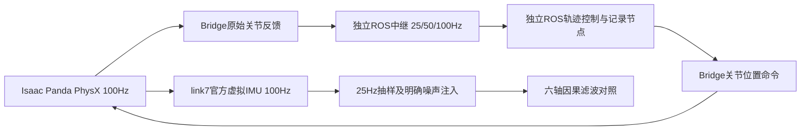

## 原任务覆盖与成果来源

| 月度计划 Week 2 内容 | 该阶段完成内容 | 数据来源与边界 |
|---|---|---|
| 读取并发布多轴状态 | 六轴 ROS2 Imu 原始/滤波节点与独立订阅验证；厂家 RAW 串口只读接口 | 发布验证使用明确标记的离线回放；真实串口分支尚未运行 |
| 静止/运动原始采集 | Panda link7 上官方虚拟 IMU 的实际物理仿真记录 | 仿真读数，不是实体板卡实测 |
| 滤波与平滑分析 | 5点移动平均、EMA、二阶 Butterworth；误差及滞后对照 | 在虚拟IMU基础上显式注入已知高斯噪声，参数不是实测估计 |
| 多种反馈频率稳定性/延迟 | 25、50、100Hz各4次正反向平衡实验 | 真实ROS Bridge与两个外部ROS节点；物理步长固定10ms |
| 频率影响比较 | 主机频率、间隔P95、消息完整性、链路延迟、跟踪误差 | 延迟定义限定链路，不声称完整硬件端到端响应 |

主实验 `runs/run002_balanced`；先导 `run001` 保留但不作为主要频率精度结论。先导9阶段存在运动方向分布不平衡，后续重跑12阶段，每个频率正/反各两次，减少该混杂因素。重复次数仍很少，同一物理场景，未做跨机器或负载条件统计。

## 仿真及实际 ROS2 链路

复用 Week1 的 Panda 资产、五次轨迹和 Isaac 独立环境，新增专用话题，不覆盖原工作空间。

仿真10ms固定步长；中继按仿真时戳抽取反馈，控制节点在每个已接收反馈时更新位置目标。因此比较的是**外环状态反馈/命令更新频率**，不是改变 PhysX 内部驱动控制频率。状态及命令使用 `/panda_week2/`，ROS domain51、localhost、FastDDS。

每阶段2秒保持、5秒五次轨迹、2秒保持，共12阶段约108秒。前三关节端点同Week1，正反方向交替，其余关节目标保持。静止区指令不变，不假设传感器完全无噪声。原始反馈接收共10798条，相邻仿真时戳最大间隔10ms，未发现超过15ms的缺口。中继发送到控制订阅的序号无缺失/重复。

IMU挂载 `/World/Panda/panda_link7/Week2IMU`，局部姿态为单位四元数，读取三轴加速度、角速度和wxyz四元数；内部滤波宽度均1。加速度读取包含重力，静态不同姿态的重力投影会改变，不能当成平移加速度。传感器频率不能高于物理频率，故该阶段上限100Hz。

## 反馈频率、误差与响应结果

表内为每频率4阶段指标的算术平均；“间隔P95平均”不是合并全部样本后的P95。关节RMSE只统计每阶段2–7秒运动窗口，比较同一时戳参考与实际位置，无滞后补偿。

| 请求Hz | 次数 | 实测主机Hz | 接收间隔P95平均 ms | 中继链路P95平均 ms | J1 RMSE rad | J2 RMSE rad | J3 RMSE rad | J1拟合滞后 ms |
|---|---:|---:|---:|---:|---:|---:|---:|---:|
| 25 | 4 | 24.891 | 40.964 | 0.259 | 0.021783 | 0.015586 | 0.016388 | 227.5 |
| 50 | 4 | 49.639 | 21.129 | 0.214 | 0.020832 | 0.014911 | 0.015675 | 217.5 |
| 100 | 4 | 99.270 | 10.891 | 0.166 | 0.020370 | 0.014582 | 0.015328 | 215.0 |

- 中继链路延迟：同一机器 monotonic 时钟下，中继 publish 调用前时刻到控制节点接收时刻，包括DDS与调度，不包含 Isaac\(\rightarrow\)中继传输，不能写成整条机器人通信延迟。
- 拟合滞后：对参考轨迹搜索0–400ms、5ms步长的时间移位，求实际关节位置最接近的移位；是驱动动态与更新链路共同形成的描述量，不是纯网络延迟。表中的原始RMSE仍未移位。
- 100Hz的主机频率约99.27Hz，存在调度抖动，不能声称硬实时。提高外环频率后J1平均RMSE略降，但幅度有限，默认物理驱动仍产生明显跟踪滞后；没有证明仅提高频率可以消除误差。
- 改善仅针对同一仿真场景、默认驱动与本条轨迹。未引入力传感、导纳、姿态融合或真实机器人控制。

